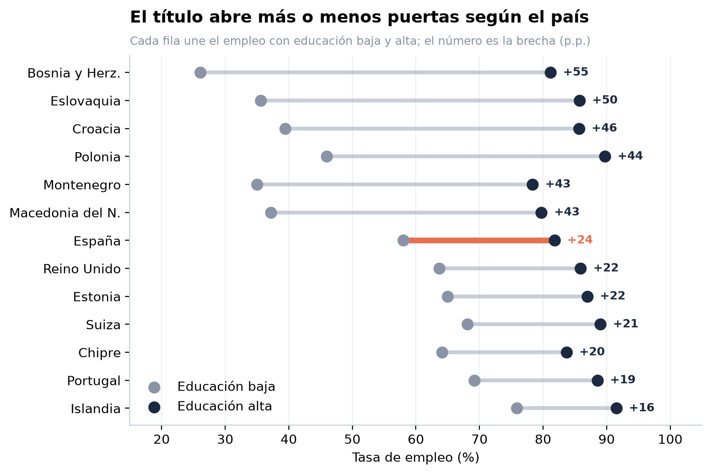
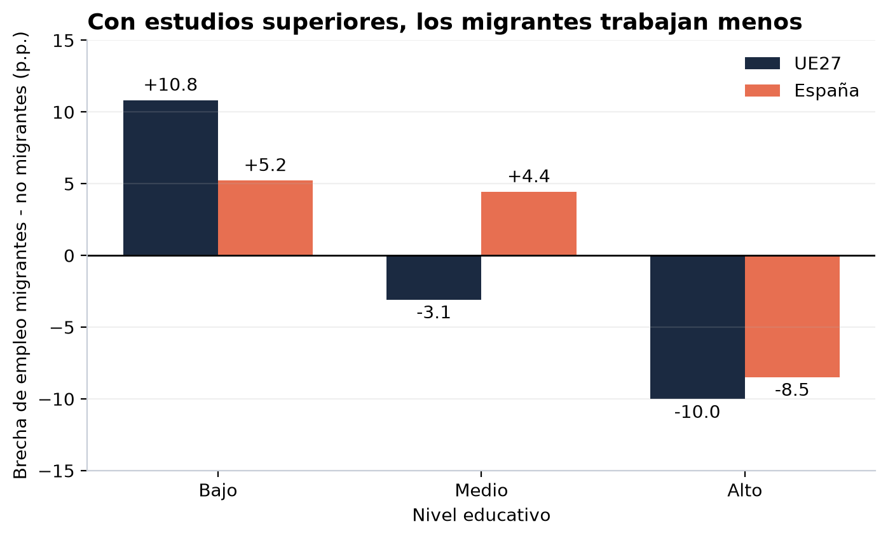
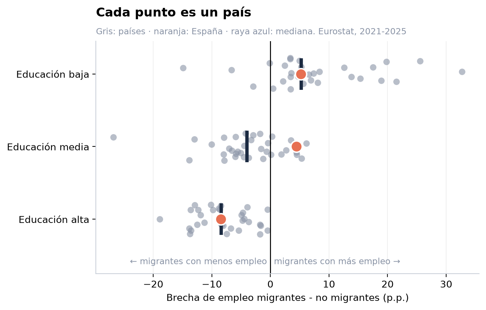
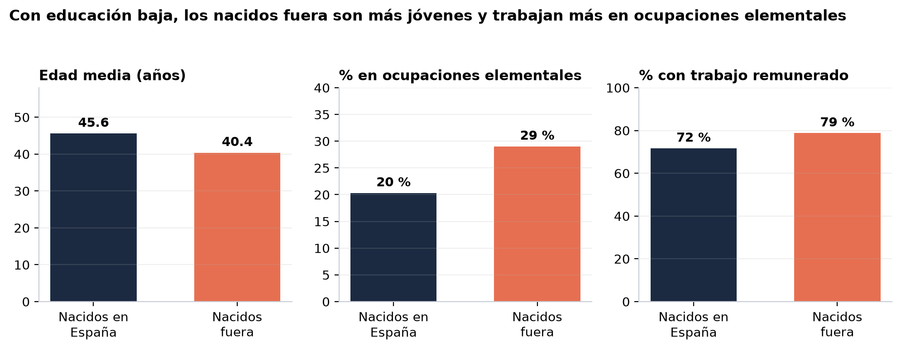
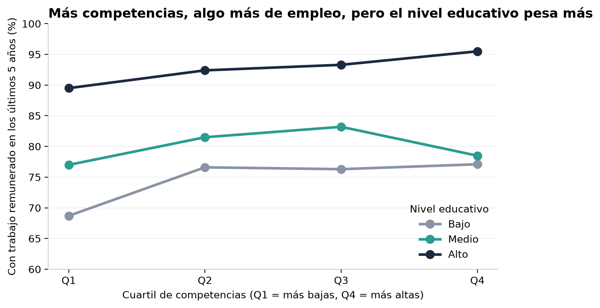
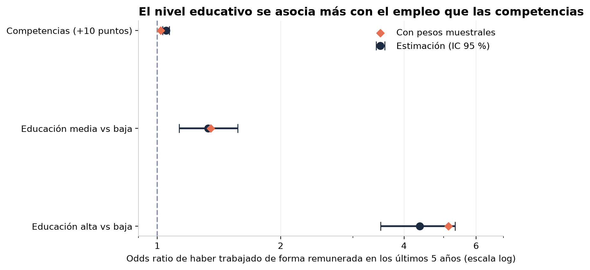
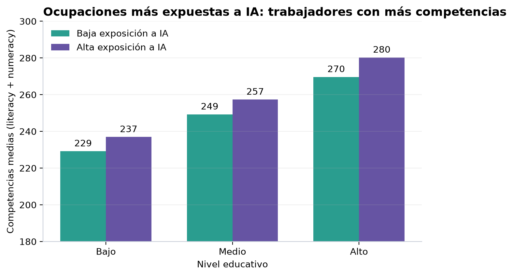

# 1. Introducción y objetivo

Este proyecto parte de una pregunta personal y práctica: ¿qué se asocia realmente con tener empleo, el título, el origen migratorio o lo que una persona sabe hacer? La autora es emigrante en España: tiene un máster en finanzas y diez años de experiencia directiva, y necesitó cuatro años para acceder a un puesto junior que no corresponde a su experiencia. La pregunta es si su caso es una excepción o refleja un patrón y, en el contexto actual de la inteligencia artificial (IA), si importan más los estudios formales o las competencias reales.

El recorrido va de lo general a lo particular: **Europa** (H1 y H2, datos de Eurostat), **España** (H3 y análisis de IA, datos de PIAAC) y, al final, el caso de la autora.

La pregunta general de investigación es: **¿qué nos permiten comprender la educación formal, la situación migratoria y las competencias cognitivas sobre las perspectivas laborales de las personas en el contexto del desarrollo de la IA?** Se plantean tres hipótesis, que forman una historia común:

| | Hipótesis | Ámbito | Resultado |
|---|---|---|---|
| **H1** | A más educación formal, mayor tasa de empleo; la magnitud varía entre países europeos. | Europa (36 países) | Confirmada |
| **H2** | A igual nivel educativo, la tasa de empleo de la población migrante es menor que la de la no migrante. | Europa (34 países) | Confirmada parcialmente |
| **H3** | En España, más competencias cognitivas (literacy y numeracy) se asocian con mejores resultados laborales, incluso a igual nivel educativo. | Solo España | Confirmada parcialmente |

Un análisis complementario exploratorio, solo para España (no una cuarta hipótesis), compara las competencias de quienes trabajan en ocupaciones con mayor y menor exposición potencial a la IA. **El proyecto no pretende demostrar causalidad ni medir el efecto de la IA**: describe asociaciones dentro de los límites de los datos.

# 2. Fuentes de datos

| Fuente | Contenido | Cobertura | Uso |
|---|---|---|---|
| Eurostat, `lfsa_ergaed` | Tasa de empleo por nivel educativo (ISCED 2011), país, año, sexo y edad | 36 países/territorios, 2015-2025, 25-64 años | H1 |
| Eurostat, `lfsa_erganedm` | Tasa de empleo por situación migratoria, nivel educativo, sexo y país | 35 geografías, 2021-2025, 15-64 años | H2 |
| OECD, PIAAC Ciclo 2, España (Public Use File) | Competencias (literacy, numeracy), educación, trabajo remunerado, ingreso, ocupación (ISCO-08) y pesos muestrales | 5.871 personas; 5.192 con nivel educativo y trabajo remunerado válidos | H3 |
| DAIOE (ISCO-08) | Índice de exposición ocupacional a IA (`daioe_allapps`, año 2025) | 424 ocupaciones | Complemento H3 |

Enlaces: Eurostat (`ec.europa.eu/eurostat/databrowser`, tablas `lfsa_ergaed` y `lfsa_erganedm`); OECD PIAAC (`oecd.org/en/data/datasets/piaac-2nd-cycle-database.html`); DAIOE (`ai-econlab.com/daioe`).

La disponibilidad y la calidad fueron los dos puntos de control del proyecto: los tres conjuntos son públicos y suficientes para las hipótesis. La principal limitación es que Eurostat ofrece tasas agregadas, no datos individuales, y que PIAAC es una encuesta transversal.

# 3. Metodología

**Limpieza y preparación.** Se eliminaron las columnas vacías y las descriptivas duplicadas. En H1 se filtró la población de 25 a 64 años, ambos sexos, y se excluyeron los agregados (UE27, zona euro) de los promedios por país. En H2 se compararon dos grupos: nacidos en el extranjero (FBO) y nacidos en el país con padres nacidos en el país (NBO_NAT), con tres niveles educativos (bajo ED0-2, medio ED3-4, alto ED5-8). No se imputaron los valores ausentes (4,3 % en H2, concentrados en Rumanía, Bulgaria y Eslovaquia: son datos no publicados por muestra insuficiente) ni se eliminaron los valores atípicos, porque corresponden a países reales cuya diferencia es parte del resultado.

**Variables derivadas.** Brecha educativa (empleo alto menos bajo), brecha migratoria (FBO menos NBO_NAT) en puntos porcentuales (p.p.), medias de los diez *plausible values* de literacy y numeracy, indicador compuesto de competencias y cuartiles de competencias.

**Análisis.** Estadística descriptiva y gráficos (univariante y bivariante); tablas cruzadas con chi-cuadrado y V de Cramér; regresión logística (odds ratios, con intervalos bootstrap y comprobación con pesos muestrales); regresión lineal sobre el logaritmo del ingreso; test de Welch para la exposición a IA. Herramientas: Python, pandas, NumPy, matplotlib, SciPy y scikit-learn. El código está en `src/main.ipynb` y `src/utils/eda_utils.py`.

# 4. Resultados

## 4.1. H1: educación y empleo en Europa

La tasa de empleo media es del 54,9 % con educación baja, 75,7 % con media y 86,1 % con alta: una diferencia de unos 31 p.p. Esa diferencia es estable entre 2015 y 2025 (entre 30 y 32 p.p.); el empleo sube en los tres niveles (unos 5 p.p.), pero la distancia no se cierra. La brecha es positiva en los 36 países y varía mucho: de 15,7 p.p. en Islandia a 55,0 en Bosnia y Herzegovina; España tiene 23,8 y la mediana es 29,9.

{width=11cm}

**Veredicto: H1 CONFIRMADA.** Se cumple en los 36 países y todos los años. Límites: son medias por grupo (no personas), no separan el efecto del título de la edad o el sector. Bosnia, Montenegro y Reino Unido tienen datos incompletos (15-18 de 33 observaciones) y los promedios son simples, sin ponderar por población.

## 4.2. H2: situación migratoria y empleo

El resultado depende del nivel educativo. En la UE27, los migrantes con educación baja tienen **más** empleo (+10,8 p.p.), con educación media algo menos (−3,1) y con educación alta bastante menos (−10,0). España sigue el patrón solo con educación alta (−8,5 p.p.); con educación baja y media los migrantes tienen más empleo (+5,2 y +4,4).

{width=11cm}

Con educación alta, los migrantes tienen menos empleo en **los 34 países con datos**; con educación media en 25 de 34 (74 %) y con baja en solo 4 de 31 (13 %). La brecha mediana con educación alta es de −8,4 p.p.

{width=9cm}

En España la brecha con educación alta se redujo de −11,2 p.p. en 2021 a −6,7 en 2025, pero persiste, y es mayor en mujeres (−11,4 p.p.) que en hombres (−4,2).

**Pistas con PIAAC (exploratorio).** Para entender por qué los migrantes con educación baja trabajan más, se usó PIAAC España, donde `BORNLANG` permite distinguir a los nacidos fuera (914 personas, 15,9 %; la lectura de los códigos 3 y 4 se dedujo de los datos, sin el libro de códigos del ciclo 2). Con educación baja, los nacidos fuera han tenido trabajo remunerado más a menudo (78,8 % frente a 71,6 %; p = 0,013), son 5 años más jóvenes (40,4 frente a 45,6; p < 0,001) y trabajan más en ocupaciones elementales (29,0 % frente a 20,3 %; p = 0,006). Son pistas compatibles con una explicación por edad y tipo de trabajo (por ejemplo, trabajo físico), no pruebas: muestras pequeñas, sin pesos ni controles.

{width=11cm}

**Veredicto: H2 CONFIRMADA PARCIALMENTE.** Se cumple con educación media (25 de 34 países) y alta (34 de 34); con educación baja ocurre lo contrario. *Por qué solo parcialmente y por qué no podemos explicarlo:* Eurostat da medias por grupo, sin edad, sector, años de residencia ni país donde se obtuvo el título, y «mismo nivel educativo» en el papel no implica el mismo reconocimiento. Un estudio más fundamental requeriría microdatos EU-LFS y medir la sobrecualificación.

## 4.3. H3: competencias cognitivas y resultados laborales en España

Las competencias medias son más altas cuanto mayor es la educación (227 en nivel bajo, 253 en medio, 275 en alto). El resultado laboral principal es haber tenido trabajo remunerado en los últimos cinco años (`PAIDWORK5`): lo tiene el 72,9 % con educación baja, el 80,3 % con media y el 93,7 % con alta.

Al dividir las competencias en cuartiles, el empleo sube de forma moderada. La asociación es significativa en el nivel bajo (p = 0,003) y alto (p = 0,007), y no en el medio (p = 0,22); la intensidad es baja (V de Cramér entre 0,06 y 0,09).

{width=11cm}

En el modelo logístico, +10 puntos de competencias se asocian con un 5 % más de odds de haber trabajado (OR 1,05; IC 95 % 1,03-1,07), mientras que tener educación alta frente a baja multiplica las odds por 4,4 (pseudo-R² = 0,08). **Con los pesos muestrales de PIAAC, el efecto de las competencias casi desaparece (OR 1,02)** y el de la educación alta aumenta (5,1): el resultado sobre competencias es frágil.

{width=11cm}

Como segundo resultado se usó el ingreso mensual (3.317 personas con ingreso declarado; `EARNMTHALLPPPC2`, en dólares estadounidenses ajustados por paridad de poder adquisitivo; los valores extremos pueden estar truncados en el archivo público): +10 puntos de competencias se asocian con +1,9 % de ingreso, frente a +55 % de la educación alta respecto a la baja (+10 % la media).

**Veredicto: H3 CONFIRMADA PARCIALMENTE.** La asociación con las competencias es positiva pero débil, y casi desaparece con pesos; el título pesa mucho más. *Por qué no podemos concluir más:* el resultado (haber trabajado en cinco años) es burdo, título y competencias están muy relacionados y la encuesta es una foto fija (2022-23). Un estudio más fundamental requeriría empleo actual y salario por hora con controles, errores estándar replicados y datos longitudinales.

## 4.4. Análisis complementario (España): exposición ocupacional a IA

El 98,7 % de las personas con ocupación válida (3.864 de 3.915) se pudo enlazar con DAIOE. Las ocupaciones se dividen en dos grupos según la mediana del índice. En los tres niveles educativos, quienes trabajan en ocupaciones con mayor exposición potencial a IA tienen competencias medias más altas: +7,7 puntos (nivel bajo), +8,1 (medio) y +10,6 (alto), todas con p < 0,01 (test de Welch).

{width=10cm}

Es una asociación descriptiva: el índice caracteriza ocupaciones, no mide el uso de IA de cada persona, y las ocupaciones más expuestas suelen ser las más cualificadas, una explicación posible que el análisis no contrasta. No permite afirmar que la IA exija más competencias ni que las aumente.

# 5. Dificultades y controles de calidad

- **Datos extensos.** El archivo de PIAAC tiene 2.483 columnas; se cargaron solo las necesarias y se documentó cada variable.
- **Criterios de filtrado coherentes.** Durante la revisión se detectó que un cálculo intermedio de H2 promediaba sexos (mujeres, hombres y total) y daba una brecha de 12,1 p.p. en educación baja en lugar de 10,5; se unificó el filtro (ambos sexos). También se corrigió una atribución errónea en un borrador (la mayor brecha de H1, 55,0 p.p., corresponde a Bosnia y Herzegovina).
- **Valores ausentes y datos incompletos.** Se analizó su distribución antes de decidir no imputarlos, y se señalaron los países con datos incompletos.
- **Medición del resultado laboral.** `PAIDWORK5` no es el empleo actual; por eso se añadió el ingreso como segundo resultado y se declaró la limitación.
- **Competencias.** La media de *plausible values* es una aproximación exploratoria; se comprobó la robustez con pesos muestrales.
- **Moneda del ingreso.** El archivo de variables del ciclo 2 (Word) no se pudo leer; la unidad (USD ajustados por PPP) se verificó con la documentación del ciclo 1 y con que la razón entre la variable en PPP y la variable por deciles/moneda es constante (1,7277). No está confirmada directamente en el libro de códigos del ciclo 2.
- **Enlace con la IA.** El enlace PIAAC-DAIOE por código ISCO-08 funcionó en el 98,7 % de los casos.

# 6. Mi suposición: ¿importan más las competencias que el título en la era de la IA?

**En estos datos, no; pero no se puede descartar para el futuro.** Pasar de educación baja a alta se asocia con +21 p.p. de personas con trabajo remunerado; pasar del cuartil de competencias más bajo al más alto, con +1,5 a +8 p.p. a igual nivel de estudios. PIAAC mide comprensión lectora y cálculo, no habilidades con IA ni estudios de matemáticas o física; es una foto fija de 2022-23; y el título puede aportar redes de contactos, señal ante quien contrata o acceso formal a puestos. Es una pregunta abierta, no una hipótesis refutada.

# 7. Conclusiones, limitaciones y siguientes pasos

**Conclusiones.** Mi caso es coherente con un patrón observable: con estudios altos, los migrantes tienen menos empleo, y el título pesa más que las competencias medidas. Los datos señalan dónde mirar, pero no explican por qué. En detalle: (1) El nivel educativo se asocia con el empleo en los 36 países, con una diferencia media de 31 p.p. (2) Con estudios superiores, los migrantes tienen menos empleo en 34 de 34 países; con estudios básicos ocurre lo contrario. (3) Las competencias medidas por PIAAC aportan información adicional, pero el título pesa mucho más; la idea de que en la era de la IA solo importan las competencias fundamentales no se ve en estos datos, aunque PIAAC mide comprensión lectora y cálculo, no estudios de matemáticas o física.

**Plan de acción y oportunidades (hipótesis para discutir).** Evaluar competencias reales además de títulos en la selección de personal; agilizar el reconocimiento de títulos extranjeros; ofrecer formación corta de recualificación a migrantes con estudios superiores.

**Limitaciones.** Datos observacionales: no hay causalidad. Promedios simples de países, sin ponderar por población. Los análisis PIAAC no usan el diseño muestral complejo (solo una comprobación con pesos). `PAIDWORK5` mide haber trabajado en cinco años, no el empleo actual. El ingreso solo existe para quienes trabajan y lo declaran. El índice de IA describe ocupaciones, no personas.

**Siguientes pasos.** (1) Microdatos EU-LFS con edad, sector, años desde la llegada y país de estudio. (2) Tasa de sobrecualificación de migrantes con estudios superiores. (3) PIAAC con pesos y errores estándar replicados, empleo actual y salario por hora con controles. (4) Más países de PIAAC. (5) DAIOE en varios años (2022-2025). (6) Estudios cualitativos sobre reconocimiento de títulos.

# Referencias

Eurostat. *Employment rates by educational attainment level* (`lfsa_ergaed`) y *Employment rates by migration status, citizenship and educational attainment level* (`lfsa_erganedm`). OECD. *Survey of Adult Skills, PIAAC Cycle 2: Public Use File, Spain*. DAIOE. *Domain-specific AI Occupational Exposure*, versión ISCO-08 (`ai-econlab.com/daioe`).
